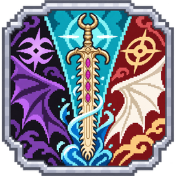
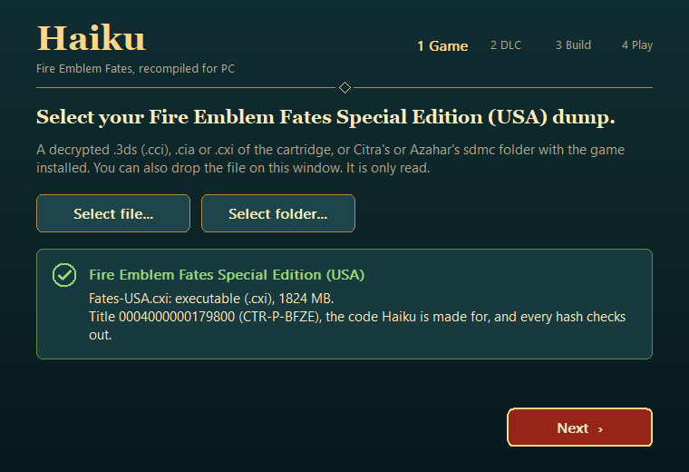
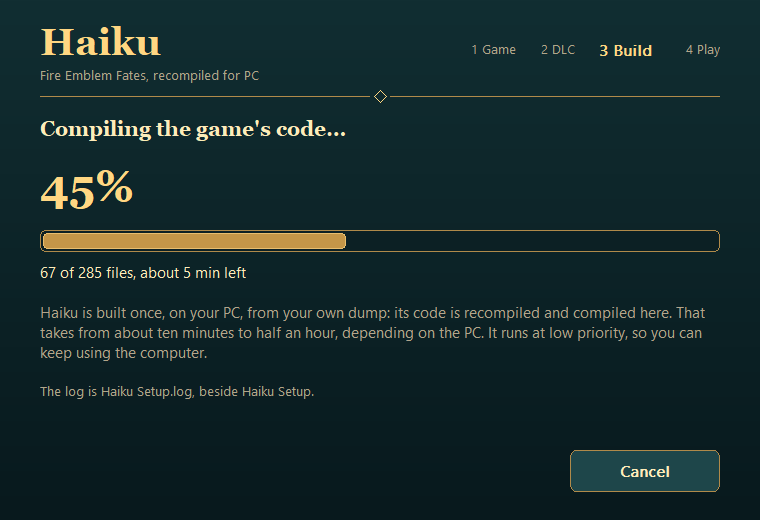
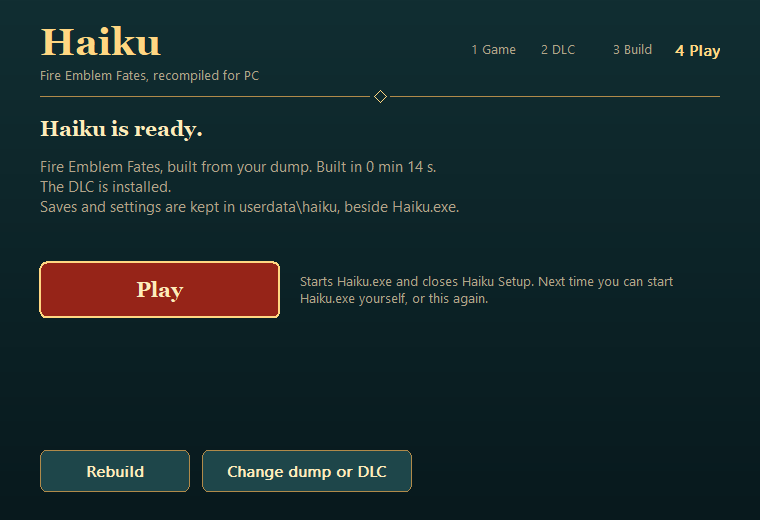

<h1 align="center">Haiku</h1>

<b>Fire Emblem Fates, recompiled for PC.</b>

Haiku is a native Windows port of Fire Emblem Fates Special Edition: the US release, the European release in five languages, and the Japanese release, *Fire Emblem if*. The game's own ARM code is statically recompiled to x86-64, and everything around it, from graphics and audio to files, saves, input and the system services, is native PC code. Nothing is emulated. On top of that it adds what a PC version should have: an options menu, controllers, widescreen and ultrawide, high frame rates, the bottom screen on one display, mods, a randomizer and online battles.

> [!IMPORTANT]
> **This repository and its downloads contain no game files.** There is no part of Fire Emblem Fates here: no code, art, audio, text or keys. To play, you need your own legally obtained copy of the game, dumped by you. Haiku builds itself on your PC from that dump. See [No game files included](#no-game-files-included).

## Screenshots

The Haiku Setup launcher, which checks your dump and builds the game:

| Your dump, checked | Building | Ready to play |
|---|---|---|
|  |  |  |

## Features

### A native port

- **Static recompilation, no emulation.** The game's code is recompiled ahead of time to native x86-64 code. There is no CPU interpreter, emulated GPU, sound chip, kernel or system service in Haiku.exe: each run ends by checking that nothing emulated ran.
- **Native Vulkan renderer.** The game's draw lists are rendered directly on your GPU, including 3D models, lighting, terrain, shadows, effects, particles and movies.
- **Native audio**: the game's own sound driver feeds a native mixer. **Native files and saves**: the game is installed as a plain folder, and saves are plain files.

### Three versions of the game

- **US** (`CTR-P-BFZE`), **European** (`CTR-P-BFZP`) and **Japanese** (*Fire Emblem if*, `CTR-P-BFZJ`) Special Editions. Haiku Setup recognises which one your dump is and builds that version; each has its own DLC and its own saves.
- **The European release** plays in English, French, German, Spanish or Italian (Options > Interface > Game Language). Haiku's own menus and added text come in every language, made from your dump.
- **The Japanese release** runs with its own script and voices, and Haiku's menus in Japanese (or English: Options > Interface > Menu Language). It keeps what the Western releases don't have: **My Room's petting minigame** (drag with the mouse), the **Festival of Bonds** and **Cipher** DLC, and **Corrin's three speaking styles** per gender.
- **Japanese voices** for the US and European releases: on Haiku Setup's Play screen, **Add Japanese voices…** takes the voice files from a dump that has them, the Japanese release or an undub, and the DLC's from the Japanese DLC. Switch between English and Japanese on the Play screen or in Options > Audio.

### Graphics

- **Render scale from 1x to 8x** the 3DS resolution.
- **High frame rates.** In-between frames are drawn at your display's refresh rate (for example 175 FPS on a 175 Hz monitor) while the game itself runs at exactly its normal speed. VSync and an FPS cap are options.
- **Anti-aliasing** (MSAA 2x, 4x or 8x).
- **Full Draw Distance**: grass and objects no longer pop in as the camera moves.
- **Windowed, borderless or exclusive fullscreen**, with a choice of monitor and resolution, ultrawide included.
- Map pixel art stays crisp at every map zoom level.

### Widescreen and ultrawide

- **16:9, 21:9 and 32:9**, as well as the original 5:3 and an automatic mode that follows the window.
- The game's 3D view is truly widened: you see more of the map and battles, with nothing stretched.
- Menus and dialogue stay centred at their original proportions, with **side panels made from the game's own ornamental art** filling the wide sides (or, if you prefer, the backdrop carried on softly, or black). Full-screen pictures such as banners, wallpapers, title cards and the Dragon Vein screen cover the sides too, and **the game's artwork is never stretched**.

### The bottom screen on one display

- **Auto** (the default): the top screen fills the window, and the bottom screen slides in only when the game shows something worth seeing on it (the unit under the cursor, the battle forecast, combat through the EXP bar, tutorials, touch screens), then slides away again. It works during combat too.
- **Always Shown**, **Manual** (show it with a key or button: tap to toggle, hold to peek), **Panel** (docked beside the top screen) and **Classic** (the console layouts).
- The floating bottom screen can be **moved** by dragging its frame and **resized** from a corner. It snaps to the window's edges, and its opacity and timing can be set.
- Touch it with the mouse, or with a cursor on the controller's right stick.

### Controls

- **Controllers through SDL3**: Xbox, PlayStation (DualShock 4, DualSense), Switch Pro and Joy-Con, and more, with hotplug.
- **Button icons** in the game's style for Xbox, PlayStation or keyboard, switching automatically or set by hand.
- **Full rebinding** for keyboard and controller, including the key that opens the options.
- **Rumble** when the battle screen shakes.
- Keyboard and mouse play: the mouse touches the bottom screen and works the options menu.

### An options menu in the game's own style

- Opens with **Esc** or the controller's **Guide/Home/PS** button, and from **Options** on the game's Main Menu. The game pauses while it's open.
- Tabs: **Display, Bottom Screen, Audio, Controls, Gameplay, Interface, Mods, Cheats**, all drawn with the game's own art and font, and usable with keyboard, mouse or controller.

### Gameplay and quality of life

- **Game Speed** from 1x up to 8x and Max, with a key to switch to fast speed and back.
- **Skip Story**: skipped story scenes aren't shown at all, while battles, boss quotes and enemy phases stay untouched.
- **Enemy Targeting Lines**: on the map, a line from each enemy to the unit its own AI will attack next enemy phase.
- **Growth Rates button** on the bottom screen's unit status.
- **Divine Pulse**, off by default: turn back time on a battle map, as in Three Houses and Engage. A timeline of the battle's moments (your actions and the enemy's) shows the map at each one as you scroll, and you confirm the one to return to. Charges grow with the story as in Three Houses (up to 13, 10 on Lunatic), or set a fixed number or unlimited; they refill every map. It's in the map menu, on a rebindable key, and it offers itself before a defeat.
- **Boon/bane stats** shown when you choose Corrin's boon and bane.
- **S-supports with anyone**: Corrin can S-support any partner, of either gender, using the game's own scenes with Corrin's lines regendered.
- **Choose Kana's gender**: ask when Kana appears, keep the game's own, male, female or random.
- **Free camera in battles**, and a **free camera in My Castle** (fly or orbit), with a smoother third-person camera when walking around My Castle.
- **Sunglasses**: a new facial detail for Corrin in the avatar creator, on every portrait and the 3D model.
- **Exit to Desktop** from the Main Menu, the map menu and the options, and **Return to Title** from the map menu and the options.
- No SpotPass questions after creating your avatar, no "Loading extra data" message at every start, and no eShop entries in the Dragon's Gate (only what you have installed).
- Saves and settings are kept **next to Haiku.exe**, in `userdata\haiku`.

### DLC and amiibo

- **DLC**: point Haiku Setup at your own DLC and its maps are in the Dragon's Gate, as on the console.
- **amiibo Hero Battles**: the battles of Marth, Ike, Lucina and Robin are in the Dragon's Gate's list, and winning one recruits that hero through the game's own script. No amiibo needed.

### Randomizer

- Start a **New Game** as **Randomizer**, **Characters** or **Classes**, chosen on the game's own screens.
- **Characters** trade places through the story, with their own portraits, names, voices, models, growths and skills. The pool has 99 characters, including story characters, **Lilith**, the **amiibo heroes** and **Kana** (of a random gender).
- **Classes** are shuffled within each character's gender and tier, with weapons to match. Corrin's own class is randomized too, and **Swap Corrin** puts your Corrin in someone else's place.
- **Seeds**: the seed is shown so a run can be shared, and a fixed seed can be set in `settings.toml`.
- Stored **per save**, with a **rules version**, so a randomized save always loads the same run and an ordinary save plays as normal.

### Cheats

A **Cheats** tab, off by default:

- **Units**: change a unit's class, stats, level, EXP and weapon ranks, give any skill, or add any character to your army.
- **Battle**: 100% critical or hit, enemies always miss, no damage, one-hit kills, move again, unlimited movement, Dragon Veins for anyone, a frozen turn count, an EXP multiplier, perfect level-ups, any class using any weapon.
- **Items & Resources**: gold, a full convoy, unlimited seals, My Castle's resources.
- **Story & Supports**: every support conversation, support ranks, and Chapter Select.
- **Save States**: eight slots with a thumbnail, the date and where you were (the chapter and turn, or My Castle), plus quick save and quick load keys. They're kept beside Haiku.exe and never touch the game's own saves.

### Mods

- A **Mods** screen, from the Main Menu or the options: turn mods on and off, set their load order, see file conflicts and missing dependencies, and **Apply and Restart**.
- Mods go in the `mods` folder next to Haiku.exe, as folders or zips. Luma3DS-style (LayeredFS) and plain `romfs/` mods work as they are, including replacement **music and sounds**, text, models and maps. File patches (.ips, .bps) are supported.
- **Texture packs**, including **Citra-format HD texture packs**. Large downloads (zips within zips, or packs split into several parts) are recognised and unpacked once, in the background.
- **Code mods**: `code.ips`, IPS32, `code.bps`, `code.bin` and `exheader.bin` patches are **recompiled to native code**, not interpreted. Haiku needs a C compiler for that and asks before downloading one.
- **Native plugins** in C (or anything that makes a DLL), with hooks before and after the game's functions, per-frame callbacks, memory access and options: see [`sdk/haiku_mod.h`](sdk/haiku_mod.h).
- **No mods come with Haiku.** Mods made by others, HD texture packs for example, belong to their authors; get them from them.
- **Haiku's own text is kept under text mods.** When a mod replaces a message file, Haiku adds its own lines to it (Kana's chosen gender, same-gender S-supports, End Turn, the Sunglasses) and fills in any line the mod's file lacks from the game's, so nothing shows up blank.
- **A code patch made for another release** (US, European or Japanese) is never applied to the build of a different one: the Mods screen says it's left out, and the mod's files are still used. A mod can name its game in `mod.toml` (`title = "0004000000179800"`).

#### Fan translations of the Japanese game

Haiku can use the fan translations made for the Japanese release, *Fire Emblem if*: **Team If's translation** (the [Fire Emblem if fan translation project](https://github.com/TeamIf/FireEmblemIf-FanTranslation)) and **cris1010's "Fire Emblem Fates Uncensored Patch"** (Team If's work continued, released on the Varis Hangout forum). Neither comes with Haiku; get them from their own pages.

- **Team If:** put the release's zip in the `mods` folder as it is, then turn it on in the Mods screen.
- **Uncensored Patch:** it comes as a RAR, which Haiku can't open. Extract it with 7-Zip (the password is on the patch's own page), and put the extracted folder (or just its `rom` folder) in `mods`.
- The patcher (IfPatcher.exe) is never run.
- **On the Japanese release** (the best fit, since the translations were made for it): the files go in as they are, and the patch's `dlc` folders are laid over your own Japanese DLC, so its patched DLC file isn't needed. You get the whole translated game with the Japan-only content: the petting minigame, the Festival of Bonds, the original script and Corrin's speaking styles. Haiku's menus and its added lines (Kana's question, same-gender S-supports) switch to English, made from the translation's own lines.
- **On the US or European release:** Haiku lays the files out as Team If's patcher does (`m/X` becomes `m/@E/X`) and trims them to what that game reads. The patch's Japanese fonts are left out: the game's own fonts draw the translation, and the few signs they can't show (such as ō, or the ≪ ≫ around dragon speech) are written as the nearest ones they can. To use the patch's fonts anyway, add `options = { fonts = 1 }` to the mod's entry in `userdata/haiku/mods.toml`. What stays as that game has it: the petting minigame is cut from its code, the Japan-only DLC can't run, DLC maps keep their English text, and a line the translation doesn't have is the game's own. **Speaking Style** (Options > Gameplay, or the avatar creator's voice) gives Corrin the Japanese script's three speaking styles. The translations work with **Voices: Japanese**; on the European release the translation shows when the Game Language is English.
- The patch's title logo is used.
- A save state remembers the mods it was made with, and won't load once a translation has been turned on or off since; the game's own saves are fine either way.

### Online battles

- **Online Battle** in the game's own Wireless Battle menu: one player picks **Host** and gets a code, the other picks **Join** and types it in. It is peer to peer, and each player brings their own team to the game's own multiplayer maps.
- The host chooses whether **characters changed with cheats** are allowed. When they aren't, such characters are greyed out when picking a team.
- **Gameplay mods must match** on both PCs, while visual mods (textures, text, sounds) can be used freely. A mismatch says which mods differ.

## Getting started

1. **Dump your game.** You need your own Fire Emblem Fates **Special Edition** cartridge (US, European or Japanese), dumped and **decrypted** with GodMode9 on your own 3DS: a `.3ds`/`.cci`, `.cia` or `.cxi`, or the sdmc folder of Citra or Azahar with the game installed. Optionally dump your DLC the same way (a decrypted `.cia`). Haiku never needs or asks for console keys.
2. **Download** `Haiku.zip` from the [Releases](https://github.com/tyle-beep/Haiku/releases) page and extract it somewhere you can write to, for example `C:\Games\Haiku`. No administrator rights are needed.
3. **Run `Haiku Setup.exe`**, select your dump, then your DLC (or continue without it).
4. **Build.** Haiku Setup checks your dump against its own hashes, installs the game's files, makes Haiku's own files from them, recompiles the game's code and compiles it with the bundled compiler. It takes **about 10 to 30 minutes**, once, and runs at low priority. If it stops, start it again and it carries on.
5. **Play.** Next time, start `Haiku.exe` directly. Press **Esc** for the options.

Your dump is only ever read. Everything Haiku makes stays in its folder.

## System requirements

- **Windows 10 or 11, 64-bit.**
- **A GPU with Vulkan** support.
- **About 3 GB of disk space**: a finished install is about 2.6 GB, most of it the game's files installed from your dump.
- The one-time build needs a fair amount of memory. Haiku Setup only starts as many compilers as your free memory allows, so a PC with less memory builds more slowly rather than failing.

## Building from source

Most players should use the release. To build Haiku yourself you need Windows x64 with Git Bash, Rust (stable), [w64devkit](https://github.com/skeeto/w64devkit) 2.11.0, Python 3 and your own dump.

- **Haiku Setup**: `cargo build --release --manifest-path builder/Cargo.toml`
- **The engine**: `cargo build --release --manifest-path source/Cargo.toml` with `FATES_RECOMP_DIR` pointing at a folder with `librecomp.a`, the game's recompiled code, which `dev/recomp.sh` makes from your dump.
- **A release folder like the one on the Releases page**: put the official SDL3 x64 `SDL3.dll` in `dist-dll/`, then `dev/builder/package.sh <out dir>`. It writes `<out dir>/Haiku` and `Haiku.zip`. The compiler's source zip comes from `dev/builder/toolchain-source.sh`.
- **The files Haiku makes from the game** (decoded UI and fonts, button icons, message files and so on) are not in this repository. `dev/builder/derived.pack` holds recipes for them, and `"Haiku Setup.exe" --apply-derived dev/builder/derived.pack <romfs> .` makes them in your checkout from a RomFS installed from your dump (the `data\romfs` folder of a Haiku Setup build).

The dev scripts take their paths from the environment (`dev/env.sh`: `HAIKU_WORK`, `HAIKU_TOOLCHAIN`, `HAIKU_DUMP`, and so on). The C files in `overrides/` replace individual game functions; [`vendor/3dsrecomp/docs/overrides.md`](vendor/3dsrecomp/docs/overrides.md) explains how. Never commit anything made from the game: `.gitignore` keeps the usual places out.

## FAQ

**Where do I get the game?**
From your own cartridge. Haiku only works with a dump you made yourself of a copy you own. This project does not provide ROMs, keys or game files, and won't help you find them. Issues asking for them are closed.

**Which version of the game works?**
Fire Emblem Fates Special Edition: the US release (`CTR-P-BFZE`), the European release (`CTR-P-BFZP`) and the Japanese release, *Fire Emblem if* (`CTR-P-BFZJ`). The DLC must be the one for the same release (the region-free DLC also works with the European game, in English). Haiku Setup tells you if a dump is a different version or edition, still encrypted, or incomplete, and if a DLC doesn't fit your game.

**Is it emulation?**
No. The game's code is recompiled into a native program ahead of time, and the 3DS's graphics, sound and system are replaced by native PC code.

**Do I need the DLC?**
No. Without it, the DLC maps aren't available. You can add it later from Haiku Setup without rebuilding the game.

**Does Haiku go online?**
Only when you play online (online battles talk directly to the other player, with a public STUN server to find a way through routers), or when you agree to download a compiler for a code mod. Haiku Setup never uses the network.

**Where are my settings and saves?**
In `userdata\haiku`, next to Haiku.exe. Haiku Setup writes a log, `Haiku Setup.log`, next to itself.

## No game files included

- This repository and the release downloads contain **no part of Fire Emblem Fates**: no code, art, audio, text, video or keys, original or modified.
- You need **your own legally obtained copy** of the game, which you dump yourself. Haiku reads your decrypted dump and never changes it.
- The game's code is recompiled, and Haiku's game-derived files are made, **on your own PC from your own dump**. What is published here is only Haiku's own code, the recipes for those files, and third-party open-source components.
- We do not provide ROMs or keys and will not help anyone obtain them. Issues or requests about getting the game are closed.
- Don't share the files Haiku builds from your dump (its `data` and `assets` folders, or a built Haiku.exe): they contain the game.

## Legal

- Haiku is an unofficial fan project. It is **not affiliated with, endorsed by or sponsored by Nintendo or Intelligent Systems**.
- **Fire Emblem** and **Fire Emblem Fates** are trademarks of Nintendo / Intelligent Systems. All other trademarks belong to their owners.
- Haiku is provided **as is, without warranty of any kind**, under the MIT License (see [LICENSE](LICENSE)).
- The release bundles a C compiler (GCC and GNU Binutils from w64devkit), which is under the **GNU GPL version 3**. Its complete source code is offered on the same release page as `Haiku-toolchain-source-w64devkit-2.11.0.zip`, next to `Haiku.zip` ([Releases](https://github.com/tyle-beep/Haiku/releases)). The GCC Runtime Library Exception means the Haiku.exe it builds is not bound by the GPL.
- **Third-party mods**, such as HD texture packs, belong to their authors. None are included with Haiku; get them from their authors.

## Licences and credits

- **Haiku**: MIT License, Copyright (c) 2026 Haiku contributors ([LICENSE](LICENSE)).
- **Zakuro** by fearkov ([github.com/fearkov/zakuro](https://github.com/fearkov/zakuro)): the 3DS runtime Haiku grew from, MIT License, `vendor/zakuro/LICENSE`. Haiku carries a modified copy in `vendor/zakuro`.
- **3dsrecomp** by fearkov ([github.com/fearkov/3dsrecomp](https://github.com/fearkov/3dsrecomp)): the static recompiler, MIT License (as its Cargo.toml declares), `vendor/3dsrecomp/LICENSE`. Haiku carries a modified copy in `vendor/3dsrecomp`.
- **SDL3** ([libsdl.org](https://www.libsdl.org)): zlib License, `dist-dll/SDL3-LICENSE.txt`. The release ships the official `SDL3.dll`.
- **SDL_GameControllerDB**: zlib License, `vendor/zakuro/crates/zakuro/data/gamecontrollerdb-LICENSE.txt`.
- **Rust crates**: the crates compiled into Haiku.exe and Haiku Setup are listed with their licences in the release's `LICENSES\Rust-crates.txt`, and their licence texts are in `LICENSES\Rust-crates-licences.txt`. They are under MIT, Apache-2.0, BSD, zlib, ISC, Unicode and similar permissive licences.
- **The compiler bundled in the release**: [w64devkit](https://github.com/skeeto/w64devkit) 2.11.0 by Christopher Wellons (the Unlicense), with **GCC 16.2.0** and **GNU Binutils 2.47** (GPL-3.0; libgcc under the GCC Runtime Library Exception 3.1), **GMP, MPFR and MPC** inside the compiler (LGPL-3.0), and the **MinGW-w64** v14.0.0 runtime (Zope Public License 2.1 and others, `LICENSES\MinGW-w64-runtime.txt`). Their source is offered as described under [Legal](#legal).
